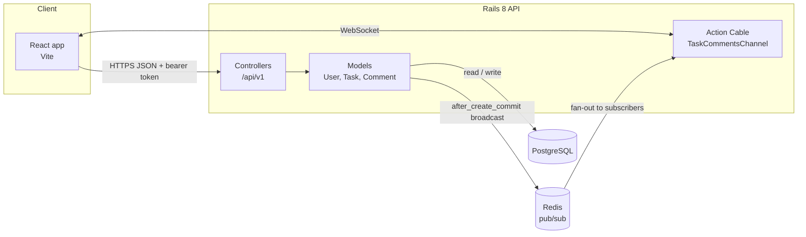
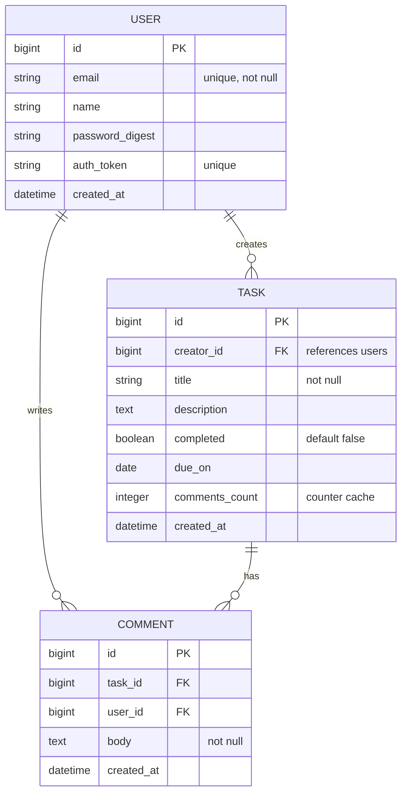
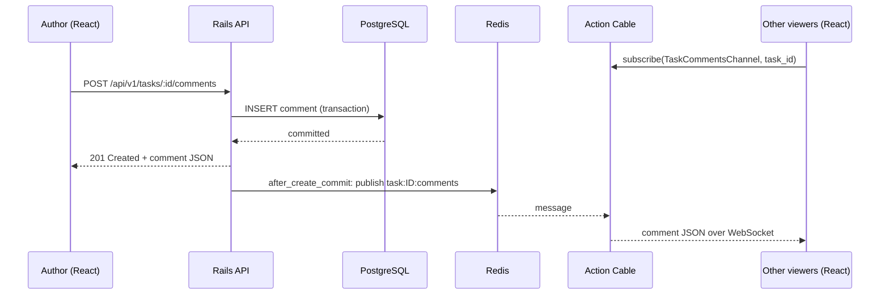

# Architecture

PostgreSQL holds every record. Redis only carries live messages between Rails processes, so losing Redis drops live updates but never loses data.

Tasks are shared: every signed-in user can see any task and comment on it. Only a task's creator can edit or delete it, and only a comment's author can delete that comment.

## System overview

## Data model

## Phase 1 endpoints

| Method | Path | Purpose | Who |
| --- | --- | --- | --- |
| POST | `/api/v1/users` | Sign up | Anyone |
| POST | `/api/v1/sessions` | Log in, returns a token | Anyone |
| GET | `/api/v1/me` | Current user | Signed in |
| GET, POST | `/api/v1/tasks` | List all tasks, or create one | Signed in |
| GET | `/api/v1/tasks/:id` | Read one task | Signed in |
| PATCH, DELETE | `/api/v1/tasks/:id` | Update or delete a task | Task creator |
| GET, POST | `/api/v1/tasks/:task_id/comments` | List or add comments on a task | Signed in |
| DELETE | `/api/v1/comments/:id` | Delete a comment | Comment author |

## Posting a comment in real time (phase 2)

Broadcasting after commit, not after save, means a viewer never sees a comment that was rolled back.
